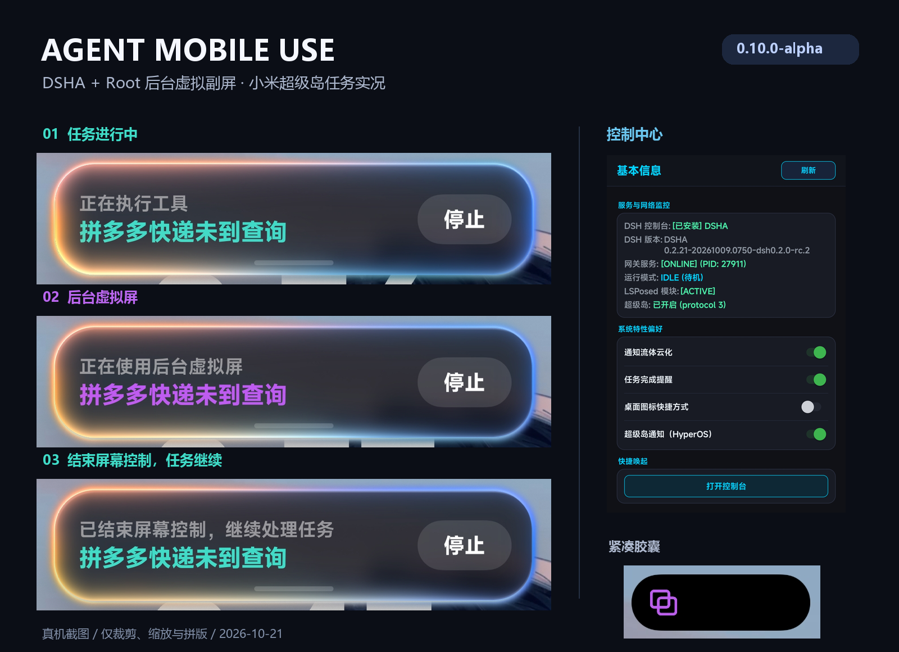

# Agent Mobile Use · DSHA Root 副屏

**面向使用 DSHA 且手机已 root 的用户，提供方便的后台虚拟副屏，并适配小米超级岛。**

DSHA 通过配套插件调用模块，在独立副屏中打开应用、截图、读屏和操作。任务进行、前台控制、后台副屏、等待回答、完成、失败和停止等状态会同步到超级岛，手机上可以查看进展、进入 DSHA 或停止任务。

[下载 v0.10.0-alpha](https://github.com/huantuoshen-prog/agent-mobile-use-hyperos/releases/tag/v0.10.0-alpha) · [安装步骤](#安装) · [使用方式](#使用) · [适配与验收](docs/live-agent-0.10.md) · [English](#english)



*图片来自 2026-10-21 真机截图，仅裁剪、缩放和拼版。展开卡片可查看任务说明并停止任务；收起后显示紧凑胶囊。*

## 能做什么

- **后台虚拟副屏**：将应用启动到模块创建的副屏，通过 DSHA 工具截图、读取控件和操作，支持与物理主屏切换。
- **DSHA 直接调用**：配套插件注册十五个工具，提供副屏创建、回收、缩放、截图、读屏、输入、应用枚举和音频设置等能力。
- **小米超级岛**：按真实任务阶段切换图标、颜色和内容，后台副屏带外圈光效；等待状态保持单个紧凑胶囊。
- **自动同步任务状态**：监听 DSHA 宿主事件，结束状态由整轮任务结果确认；todo 清单提供实际进度数量。
- **手机端停止**：通知按钮绑定当前会话和轮次，发送停止请求并等待 DSHA 确认结果。

## 环境

| 项目 | 本次验证环境 |
| --- | --- |
| DSHA | Android App build170，DSH 0.2.0-rc.2 |
| 模块 | KernelSU + LSPosed，模块 0.10.0-alpha |
| 手机 | Redmi K90，HyperOS 4 / Android 17，ARM64 |
| 配套插件 | dsh-mobile-use 0.3.0 |

核心使用路径：**DSHA → mobile-use 插件 → 本机网关 → KSU 模块副屏**。模块副屏不要求开启 DSHA 的 Root Shell 开关或创建 DSHA 自带副屏；模块运行所需的 root 由模块环境提供。

小米超级岛需要设备支持及相应的 LSPosed 作用域。ColorOS 路径保留，其他 ROM 和 Android 版本尚未完成本轮真机验收。

## 安装

从 [Release](https://github.com/huantuoshen-prog/agent-mobile-use-hyperos/releases/tag/v0.10.0-alpha) 下载两个 ZIP：

| 文件 | 用途 |
| --- | --- |
| `agent-mobile-use-ksu-v0.10.0-alpha.zip` | 在 KernelSU 管理器安装，包含网关、运行时和控制台 APK |
| `dsh-mobile-use-0.3.0.zip` | 在 DSHA 自带插件管理器导入 |
| `SHA256SUMS.txt` / `live-agent-0.10.0-manifest.json` | 下载校验及包内二进制校验 |

1. 安装 KSU 模块，确认 LSPosed 中本模块已启用，然后重启并首次解锁手机。
2. 从 LSPosed 的模块设置入口打开控制中心，确认网关 ONLINE、LSPosed ACTIVE。允许控制台发送通知，开启“超级岛通知（HyperOS）”。
3. 在 DSHA 的插件管理器导入插件 ZIP，按界面提示确认安装，重启 DSHA Web。
4. 确认 `dsh-mobile-use` 已加载；让 DSHA 调用 `mobile_status`，检查网关状态。

升级前保留现有数据和构件。历史控制台 APK 使用过不同签名；普通设备可能无法直接覆盖，安装脚本会在 APK 安装失败时停止。本轮测试机具备核心签名破解，已实际覆盖并核验数据保留；该结果不能推定为普通设备的跨签名升级能力。

## 使用

在 DSHA 中说明使用模块副屏，例如：

> 使用 mobile-use 的后台副屏打开系统设置，只读取界面并截图，不改设置。完成后退出屏幕控制并回收副屏。

典型工具流程：

```text
mobile_start
  → mobile_mode(background)
  → mobile_action(launch_app)
  → mobile_ui_dump / mobile_screenshot / mobile_action
  → mobile_mode(idle)
  → mobile_stop
```

`foreground` 操作物理主屏，`background` 操作模块副屏；切换后重新读屏再决定操作坐标。没有应用时先用 `launch_app` 启动目标应用。

可回答的问题使用 DSHA 的 `ask_user_question`。插件自动显示等待状态，答案由 DSHA 处理；`mobile_question` 仅投递问题通知。

| 任务状态 | 超级岛表现 |
| --- | --- |
| 任务进行中 | 青绿色终端 |
| 前台控制 | 蓝色眼睛 |
| 后台副屏 | 紫色双窗口、外圈光效 |
| 等待回答 | 琥珀色问号 |
| 任务完成 | 绿色勾 |
| 执行失败 | 红色叉 |
| 任务已停止 | 灰色停止图标 |

结束屏幕控制后，DSHA 可以继续处理任务；整轮任务结束后才产生最终结果通知。停止请求不能撤销已经执行的设备或外部操作。

## 本轮验收

- 正式 DSHA 模型任务完成模块副屏创建、应用启动、截图读屏、前后台切换和回收。
- 真实提问、手机提交答案、完成通知，以及通知停止按钮中断 DSHA 均已验证。
- 七种状态已检查系统通知载荷；前台、后台和等待状态已目视核对。展开态外圈效果另见上方手机截图。
- 重启后自动启动、私有 token 交付、通知权限、个性化设置和 LSPosed 作用域保留通过；再次真实调用 `mobile_status` 成功。
- 19 项 Go 顶层测试、7 项 Node 测试、Java 82 项载荷检查及七状态检查通过。

[完整协议与验收边界](docs/live-agent-0.10.md) · [HyperOS 适配说明](docs/hyperos.md) · [插件工具清单](dsha-plugin/README.md)

## 开发

```sh
node --test dsha-plugin/test/gateway.test.cjs dsha-plugin/test/lifecycle.test.mjs
(cd vd-server-go && go test ./...)
```

Android 构件使用 JDK 17、Android SDK 和 Go 构建。Windows 构建入口为 `tools/build-windows.py`；Linux 使用 `agent-hook-apk/build-ci.sh` 与 `tools/build-runtime-ci.sh`。持续集成检查源码、测试及未签名编译；Release 使用单独保存的固定签名密钥。未签名 CI APK 仅供编译检查。

控制网关默认监听 `127.0.0.1:3070`，敏感接口使用应用私有 token；插件不需要读取模型 API key。签名私钥、设备 token、日志和备份均不随源码发布。

## English

Agent Mobile Use provides a root-backed background virtual display for **DSHA users with rooted Android phones**, with Xiaomi HyperOS Super Island task notifications. The DSHA plugin exposes fifteen tools and follows real host lifecycle events for running, foreground, background, waiting, completed, failed and cancelled states.

Install the KernelSU module and the matching DSHA plugin from the release. This module's display backend does not require DSHA's separate built-in virtual-display permission. The current device-tested setup is Redmi K90, HyperOS 4 / Android 17, KernelSU, LSPosed and DSHA build170. Other ROMs require separate validation. Historical APK signatures may prevent a normal overwrite upgrade; back up first.

## 来源与许可

基于 [AcidGr/agent-mobile-use](https://github.com/AcidGr/agent-mobile-use) 继续开发。HyperOS 协议参考 [小米开发指南](https://dev.mi.com/xiaomihyperos/documentation/detail?pId=2131) 和 MIT 项目 [HyperIsland](https://github.com/1812z/HyperIsland)。保留原作者酸小明（AcidGr）的版权声明，源码采用 [MIT License](LICENSE)。
