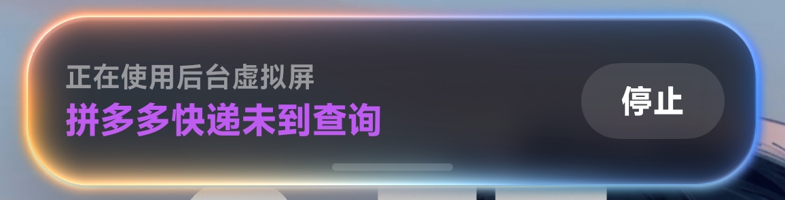
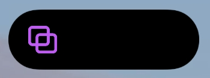

# HyperOS 超级岛适配 · 0.10.0-alpha

本项目面向使用 DSHA 且已 root 的用户，通过模块提供后台副屏，并将任务进展同步到小米超级岛。当前真机验收环境为 Redmi K90、HyperOS 4 / Android 17、KernelSU 与 LSPosed。

## 开启

1. 安装模块并重启，首次解锁后等待网关启动。
2. 确认 LSPosed 中模块启用，作用域含 `android`、`com.android.systemui`、`com.agent.mobileuse`、`com.xiaomi.xmsf`。
3. 允许控制台发送通知，在模块控制中心开启“超级岛通知（HyperOS）”。
4. 在 DSHA 导入配套插件并重启 Web，先调用 `mobile_status`。

模块后台副屏由 KSU 环境提供，无需开启 DSHA 自带副屏或 DSHA 的 Root Shell 开关。

## 真实界面

展开卡片展示阶段说明、会话标题和停止按钮；收起后使用紧凑图标胶囊。截图仅裁剪原始像素，完整桌面和无关通知未发布。

## 协议

通过原生 Notification 的 `miui.focus.param` 写入 `param_v2`，图片资源使用 `miui.focus.pics`，动作资源同时放入 `miui.focus.actions` 和通知 extras 顶层。JSON 的 `action` 引用动作资源；`actionIntent` 用于序列化 Intent URI。

`islandProperty=1` 表示信息展示，`2` 表示以操作为主；`islandTimeout` 单位为秒。`enableFloat` 控制更新时自动展开，不影响手动展开。当前普通状态更新关闭自动展开。

本机采用显式焦点通知载荷，避免 HyperOS 将 promoted Android Live Updates 转换成系统模板而覆盖自定义状态。后台状态使用 `outer_glow` 效果。基础文字按钮模板只保留一个停止主按钮，整张通知提供查看入口。

等待事件携带 session/turn，复用当前实况胶囊，避免异步投递产生两条等待通知。个性化偏好通过控制台设置；Android 17 可能将偏好重定位至 `/data/misc/apexdata/<uuid>/prefs/com.agent.mobileuse/`，不要手动写入旧路径。

## 系统边界

Hook 限定到本应用的焦点通知与已核对的调用参数；未知系统方法签名或其他 ROM 需要重新验收。Hook 涉及 SystemUI 和系统服务，升级前保留当前可恢复构件。

本轮已验证七状态系统载荷、真实 DSHA 提问与停止、前后台切换、首次解锁后的 token 交付和重启后的权限保留。详见 [完整验收记录](live-agent-0.10.md)。

依据：[小米开发指南](https://dev.mi.com/xiaomihyperos/documentation/detail?pId=2131)、[HyperIsland](https://github.com/1812z/HyperIsland)。
